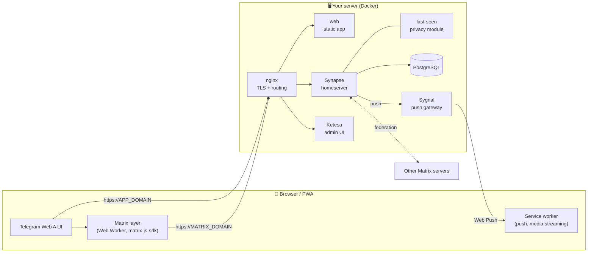

<div align="center">


# Peyvand

**A self-hosted messenger that looks and feels like Telegram, running on your own [Matrix](https://matrix.org) server.**

End-to-end encryption · Your server, your data · Web app + installable PWA · One-command setup

[Features](#-features) · [Architecture](#-architecture) · [Install](#-install) · [Configuration](#-configuration) · [Development](#-development) · [Troubleshooting](#-troubleshooting)

<br>


<br><br>

&nbsp;&nbsp;


</div>

---

## Why Peyvand?

Telegram's web client is one of the best chat interfaces ever built. Matrix is an open, federated protocol you can run yourself. **Peyvand puts them together.**

- The UI is the [Telegram Web A](https://github.com/Ajaxy/telegram-tt) client, kept nearly intact.
- Its Telegram networking layer is replaced with a **Matrix layer** (`client/src/api/matrix/`).
- Everything goes to **your** homeserver: the app never contacts Telegram's servers.

You get Telegram's speed, animations and polish. Users sign up with an invite code on **your** server, chats can be end-to-end encrypted, and other Matrix apps (Element, Cinny, …) can talk to the same accounts.

## ✨ Features

| | |
|---|---|
| 💬 **Messaging** | Private chats, groups and channels, replies, edits, forwards, pins, drafts, search |
| 🔐 **End-to-end encryption** | Matrix E2EE (Olm/Megolm) with a recovery key or passphrase to restore history on new devices |
| 📁 **Chat folders** | Telegram-style folders and filters, synced across devices |
| ✅ **Checklists** | Shared to-do lists in chats: others can tick items or add tasks |
| 😍 **Reactions** | Full emoji picker, double-tap quick reaction (choose your own emoji) |
| 👀 **Read receipts** | See who read a message in a group, and when |
| 🔔 **Mentions & notifications** | `@username` mentions with the @ badge, Web Push notifications through your own push gateway |
| 🏷️ **Member tags** | Custom labels next to group members ("Designer", "Support", …) |
| 🕶️ **Last-seen privacy** | Everybody / My Contacts / Nobody plus per-person and per-group exceptions, **enforced on the server** (server admins always see exact times) |
| 🎙️ **Voice & video messages** | Record voice or round video messages, switch to the back camera while recording, 1×/1.5×/2× playback, seek by dragging |
| 📎 **Media** | Photos, videos, files, music, albums, encrypted uploads, streaming playback with seeking |
| 📱 **Mobile-first** | Installable PWA, swipe back from a chat, swipe to reply, smooth Telegram animations |
| ⭐ **Premium for all** | Features Telegram reserves for Premium are unlocked for every user |
| 🛡️ **Server Admin panel** | In-app panel for admins: users, passwords, deactivation, invite codes. Ketesa (Synapse Admin) is included too |
| 🌍 **Languages** | English UI, with a bundled Persian (RTL) language pack and the Vazirmatn font |
| 🔗 **Federation** | It's Matrix: talk to users on other Matrix servers |

## 🏗 Architecture



| Domain | Serves |
|---|---|
| `APP_DOMAIN` (e.g. `chat.example.com`) | The Peyvand web app |
| `MATRIX_DOMAIN` (e.g. `matrix.example.com`) | Synapse (client and federation API), `/admin/` (Ketesa), the push gateway and `.well-known` |
| `CINNY_DOMAIN` (optional) | [Cinny](https://cinny.in), a second Matrix web client |

All containers listen on `127.0.0.1`. The host's nginx is the only public entry point.

## 📂 Repository layout

```
tele-matrix/
├── client/                    # Web app: Telegram Web A + the Matrix layer
│   └── src/api/matrix/        # ← the Matrix implementation of the client API
├── server/
│   ├── compose.yml            # Synapse, Postgres, Sygnal, web, Ketesa, (Cinny)
│   ├── synapse/modules/       # peyvand_last_seen.py: last-seen privacy module
│   ├── templates/             # Config templates rendered by scripts/setup.sh
│   └── data/                  # ← generated: configs, secrets, database (git-ignored)
├── scripts/
│   ├── setup.sh               # Generates every config, secret and key from .env
│   ├── build-client.sh        # Builds the web app (in Docker) into server/data/www
│   ├── create-admin.sh        # Creates a server admin
│   └── new-invite.sh          # Creates a sign-up invite code
├── tests/e2e/                 # Playwright end-to-end scripts
├── brand/                     # Logo and icon generator
└── .env.example               # The only file you need to edit
```

## 🚀 Install

### Requirements

- A Linux server with **2 GB RAM** or more (building the client needs about 4 GB, or add swap)
- **Docker** with the Compose plugin, **nginx**, **openssl**, **rsync** and **certbot**
- Two DNS records pointing to the server: one for the app, one for the homeserver (plus one more for Cinny)

> [!IMPORTANT]
> `MATRIX_DOMAIN` becomes part of every user ID (`@alice:matrix.example.com`) and **cannot be changed later**. Choose it carefully.

### 1. Clone and configure

```bash
git clone https://github.com/Amin-tvk/tele-matrix.git
cd tele-matrix
cp .env.example .env
nano .env        # set APP_DOMAIN, MATRIX_DOMAIN, ADMIN_EMAIL, PUSH_APP_ID
```

### 2. Generate configs and secrets

```bash
sudo scripts/setup.sh
```

This creates `server/data/` with:

- the Synapse config, including random secrets;
- the database password;
- the server's signing key;
- the Web Push (VAPID) key pair;
- the Sygnal, Ketesa and Cinny configs;
- a ready-made nginx site.

Running it again is safe: existing files are never overwritten.

> [!CAUTION]
> `server/data/` holds your secrets, your database and every uploaded file. **Back it up**, and never commit it.

### 3. Start the server

```bash
docker compose -f server/compose.yml up -d
docker compose -f server/compose.yml logs -f synapse   # wait for "Synapse now listening"
```

Add `--profile cinny` to also start Cinny.

### 4. Build the web app

```bash
scripts/build-client.sh
```

This installs dependencies and builds with Vite inside Docker (Node isn't needed on the host). The result is published to `server/data/www`. The first build takes a few minutes.

### 5. HTTPS and nginx

Get a certificate for each domain, then install the generated site:

```bash
sudo apt install certbot python3-certbot-nginx
sudo certbot certonly --nginx -d chat.example.com
sudo certbot certonly --nginx -d matrix.example.com

sudo cp server/data/nginx/peyvand.conf /etc/nginx/conf.d/peyvand.conf
sudo nginx -t && sudo systemctl reload nginx
```

<details>
<summary>Behind a CDN (Cloudflare, ArvanCloud, …)?</summary>

1. Point the certificate paths in `peyvand.conf` at your CDN's origin certificate.
2. Set the CDN's SSL mode to *Full*.
3. Make sure the CDN doesn't cache `/_matrix/*` or `/_synapse/*`.

</details>

### 6. Create the first admin

```bash
scripts/create-admin.sh alice
```

Open `https://APP_DOMAIN` and sign in.

- As an admin, you'll find **Settings → Server Admin**, where you can create users and invite codes.
- New users sign up with an invite code. Registration is invite-only by default.

### 7. Check federation (optional)

Open `https://federationtester.matrix.org/#MATRIX_DOMAIN`. Every check should be green.

## ⚙️ Configuration

### `.env`

| Variable | Description |
|---|---|
| `APP_DOMAIN` | Domain of the web app |
| `MATRIX_DOMAIN` | Domain of the homeserver. Also the server name in user IDs |
| `CINNY_DOMAIN` | Optional domain for Cinny |
| `ADMIN_EMAIL` | Contact address sent to browser push services |
| `APP_TITLE` | App name in the browser tab and when installed (default `Peyvand`) |
| `PUSH_APP_ID` | Web Push app ID shared by the client and Sygnal |

`scripts/build-client.sh` turns these into the client's build variables:

| Build variable | Comes from |
|---|---|
| `MATRIX_HOMESERVER` | `MATRIX_DOMAIN` |
| `BASE_URL` | `APP_DOMAIN` |
| `VAPID_PUBLIC_KEY` | `server/data/sygnal/vapid_public.txt` |
| `PUSH_APP_ID` | `PUSH_APP_ID` |
| `APP_TITLE` | `APP_TITLE` |

After changing `.env`, run the build again.

### Synapse

Edit `server/data/synapse/homeserver.yaml`, then run:

```bash
docker compose -f server/compose.yml restart synapse
```

Common changes:

- **Open registration:** set `registration_requires_token: false`. Use this only with a captcha or email verification.
- **Upload limit:** `max_upload_size` (also change `client_max_body_size` in nginx).
- **Email** (password resets, notifications): see the [Synapse docs](https://element-hq.github.io/synapse/latest/usage/configuration/config_documentation.html#email).

### Invites

You can create invite codes in three ways:

- in the app, under **Settings → Server Admin → Invites**;
- at `https://MATRIX_DOMAIN/admin/` (Ketesa);
- from the shell:

```bash
ADMIN_TOKEN=<admin access token> scripts/new-invite.sh 5 30   # 5 uses, valid for 30 days
```

### Last-seen privacy module

`server/synapse/modules/peyvand_last_seen.py` replaces Synapse's built-in presence, which is turned off. Built-in presence shows everyone's status to anyone in a shared room.

The module:

- records activity from the app's heartbeat and from Synapse's own request log;
- applies each user's rules (stored in their account data) on the server;
- serves approximate times (*recently*, *within a week*, *within a month*) to people who aren't allowed to see the exact time.

Server admins always see exact times.

> [!NOTE]
> Because built-in presence is off, other Matrix apps (Element, Cinny) don't show online status.

## 🔄 Updating

```bash
git pull
docker compose -f server/compose.yml pull
docker compose -f server/compose.yml up -d
scripts/build-client.sh
```

Existing configs in `server/data/` are left as they are. Compare them with `server/templates/` when a release notes a config change.

**Backups:** stop the stack, then archive `server/data/`. It holds the database, media, signing key and secrets. You can also run `pg_dump` from the `postgres` container while the stack is running.

## 🛠 Development

```bash
cd client
npm ci
MATRIX_HOMESERVER=https://matrix.example.com npm run dev   # http://localhost:1234
```

The homeserver must allow CORS from your dev origin. Synapse allows all origins by default.

| Command | |
|---|---|
| `npx tsc --noEmit -p .` | Type check |
| `npx eslint <files>` | Lint |
| `npm run build:production` | Production build into `client/dist` |

**How the Matrix layer fits in.**

- The UI calls API methods by name (`callApi('sendMessage', …)`).
- Upstream, those methods are implemented with Telegram's MTProto in `src/api/gramjs/`.
- Here, `src/api/matrix/` implements the same methods on top of `matrix-js-sdk`, inside a Web Worker.
- `typecheck.ts` checks at compile time that every Matrix method matches the UI's expected signature.

| File | Role |
|---|---|
| `client.ts` | Sync loop, live events |
| `builders.ts` | Matrix events → Telegram-shaped objects |
| `methods.ts` | Most API methods |
| `encryption.ts` | Encryption and key recovery |
| `media.ts` | Uploads, downloads, streaming |
| `folders.ts` | Chat folders |
| `todo.ts` | Checklists |
| `lastSeen.ts` | Last seen and its privacy settings |
| `admin.ts` | Server Admin panel |

**Custom Matrix event types used by Peyvand.** Other clients ignore them safely, and checklists fall back to a plain-text list.

| Type | Purpose |
|---|---|
| `im.peyvand.member_tag` | State event: member tags (state key `member:<userId>`) |
| `im.peyvand.chat_folders` | Account data: folders |
| `im.peyvand.privacy` | Account data: last-seen rules |
| `im.peyvand.quick_reaction` | Account data: quick reaction emoji |
| `im.peyvand.todo` / `im.peyvand.todo.update` | Checklist content / ticks and added tasks |
| `im.peyvand.forward` | "Forwarded from" info on copied messages |

### End-to-end tests

`tests/e2e/` holds Playwright scripts that drive a real deployment.

1. Build the runner image. The scripts use Playwright from `client/node_modules`, so run `scripts/build-client.sh` once first:

   ```bash
   docker build -t peyvand-test tests/e2e
   ```

2. Create a few test accounts on your server.
3. Write them to `tests/e2e/creds.txt`, one `username password` per line. This file is git-ignored.
4. Run a script against your deployment:

   ```bash
   docker run --rm --network host -e MOBILE=1 -e APP_URL=https://chat.example.com/ \
     -v "$PWD/client:/app:ro" -v "$PWD/tests/e2e:/test" peyvand-test node /test/mobile2.mjs
   ```

Screenshots are saved to `tests/e2e/out/`.

## 🩺 Troubleshooting

<details>
<summary><b>The app still shows the old version after an update</b></summary>

The service worker serves the previous build on the first load after a deploy. Reload once more, or close and reopen the installed app.
</details>

<details>
<summary><b>"Encrypted message" / can't read old messages on a new device</b></summary>

Open **Settings → Encryption** and enter your recovery key. Set one up on your first device so history can be restored later.
</details>

<details>
<summary><b>No push notifications</b></summary>

Check these, in order:

1. The client was built after `setup.sh` created the VAPID key. `scripts/build-client.sh` prints a warning if not.
2. `PUSH_APP_ID` is the same in `.env` and `server/data/sygnal/sygnal.yaml`.
3. `https://MATRIX_DOMAIN/_matrix/push/v1/notify` reaches Sygnal.
4. The browser allowed notifications. On iOS, push works only for the app added to the Home Screen.
</details>

<details>
<summary><b>Voice or video messages can't be seeked</b></summary>

Media is streamed through the service worker with HTTP range requests. If a CDN sits in front of `MATRIX_DOMAIN`, make sure it forwards the `Range` header and doesn't cache `/_matrix/client/v1/media/`.
</details>

<details>
<summary><b>Synapse doesn't start: permission denied in /data</b></summary>

Synapse runs as UID 991. Fix the ownership:

```bash
sudo chown -R 991:991 server/data/synapse
```
</details>

<details>
<summary><b>Federation tester fails</b></summary>

`https://MATRIX_DOMAIN/.well-known/matrix/server` must return `{"m.server":"MATRIX_DOMAIN:443"}`. Port 443 must also be reachable from the internet, not only through a CDN that blocks federation traffic.
</details>

## 🙏 Credits

- [**Telegram Web A**](https://github.com/Ajaxy/telegram-tt) by Alexander Zinchuk and contributors: the UI this project is built on
- [**Matrix**](https://matrix.org), [**Synapse**](https://github.com/element-hq/synapse), [**matrix-js-sdk**](https://github.com/matrix-org/matrix-js-sdk) and [**Sygnal**](https://github.com/matrix-org/sygnal)
- [**Ketesa**](https://github.com/etkecc/ketesa) (Synapse admin UI) and [**Cinny**](https://github.com/cinnyapp/cinny)
- [**Vazirmatn**](https://github.com/rastikerdar/vazirmatn) font by Saber Rastikerdar

Peyvand is not affiliated with Telegram.

## 📄 License

[GPL-3.0](LICENSE), the same license as Telegram Web A, which this project is based on. If you distribute a modified version, you must publish its source under the same license.
