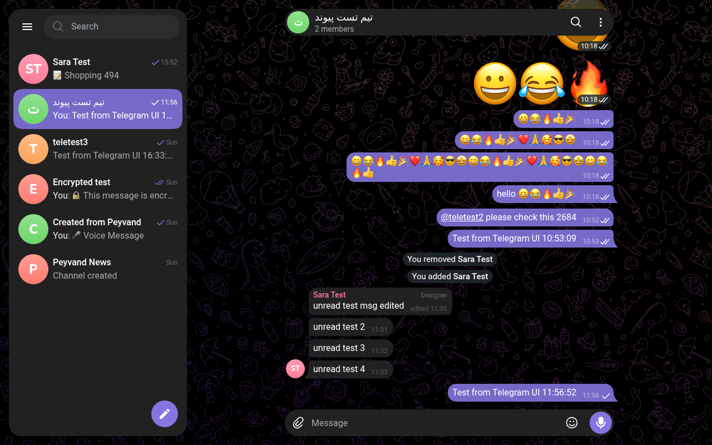
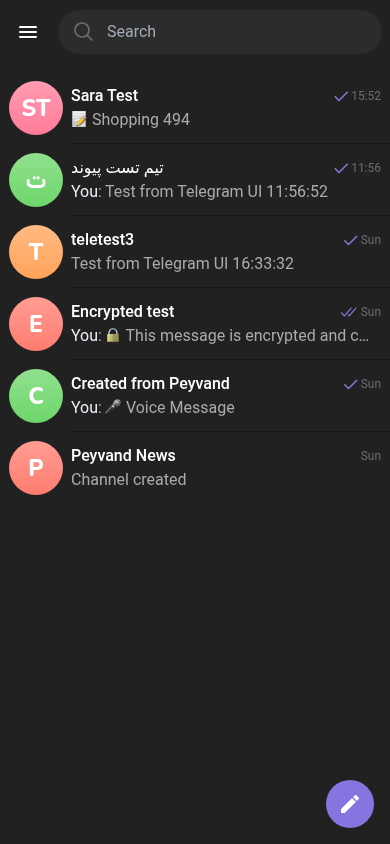
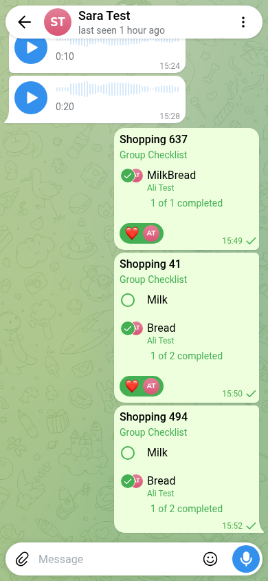
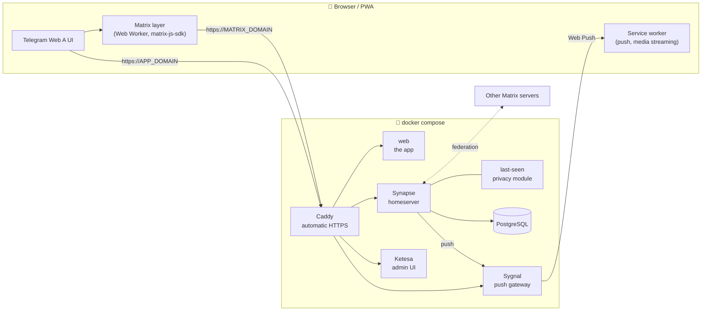

<div align="center">


# Peyvand

**A self-hosted messenger that looks and feels like Telegram, running on your own [Matrix](https://matrix.org) server.**

End-to-end encryption · Your server, your data · Web app + installable PWA · `docker compose up` and done

[Features](#-features) · [Install](#-install) · [Configuration](#-configuration) · [Architecture](#-architecture) · [Development](#-development) · [Troubleshooting](#-troubleshooting)

<br>



<br><br>

&nbsp;&nbsp;


</div>

---

## Why Peyvand?

Telegram's web client is one of the best chat interfaces ever built. Matrix is an open, federated protocol you can run yourself. **Peyvand puts them together.**

- The UI is the [Telegram Web A](https://github.com/Ajaxy/telegram-tt) client, kept nearly intact.
- Its Telegram networking layer is replaced with a **Matrix layer** (`client/src/api/matrix/`).
- Everything goes to **your** homeserver: the app never contacts Telegram's servers.

You get Telegram's speed, animations and polish. Users sign up with an invite code on **your** server, chats can be end-to-end encrypted, and other Matrix apps (Element, Cinny, …) can talk to the same accounts.

## ✨ Features

| | |
|---|---|
| 💬 **Messaging** | Private chats, groups and channels, replies, edits, forwards, pins, drafts, search |
| 🔐 **End-to-end encryption** | Matrix E2EE (Olm/Megolm). The key backup is created on the first sign-in and protected by the account password, so a new device reads earlier messages right after signing in. Verifying from another device by comparing emojis works too |
| 📶 **Weak networks** | Messages and uploads wait out dropped connections and send themselves when it's back, with a clock until delivered |
| 📁 **Chat folders** | Telegram-style folders and filters, synced across devices |
| ✅ **Checklists** | Shared to-do lists in chats: others can tick items or add tasks |
| 😍 **Reactions** | Full emoji picker, double-tap quick reaction (choose your own emoji). Your most used reactions come first, on every device |
| 💬 **Channel comments** | Channel admins turn on comments; subscribers comment under each post, like Telegram's discussion, without a separate group |
| ☑️ **Blue ticks** | Server admins give verified ticks to people and channels. Verified people can show an emoji of their choice instead |
| 📸 **Stories** | People with the blue tick post photo and video stories for 24 hours, and can keep them in their profile's Posts tab |
| 🔒 **Passcode lock** | Offered after signing in: locks the app on the device, by hand or automatically after 1 minute to 1 hour away |
| 👀 **Read receipts** | See who read a message in a group, and when |
| 🔔 **Mentions & notifications** | `@username` mentions with the @ badge, Web Push notifications through your own push gateway |
| 🏷️ **Member tags** | Custom labels next to group members ("Designer", "Support", …) |
| 🕶️ **Last-seen privacy** | Everybody / My Contacts / Nobody plus per-person and per-group exceptions, **enforced on the server** (server admins always see exact times) |
| 📞 **Voice & video calls** | One-to-one calls over Matrix VoIP, with the bundled coturn relay so calls connect behind mobile NAT. Work with Element too |
| 🎙️ **Voice & video messages** | Record voice or round video messages, switch to the back camera while recording, 1×/1.5×/2× playback, seek by dragging |
| 📎 **Media** | Photos, videos, files, music, albums, encrypted uploads, streaming playback with seeking |
| 📱 **Mobile-first** | Installable PWA, swipe back from a chat, swipe to reply, smooth Telegram animations |
| ⭐ **Premium for all** | Features Telegram reserves for Premium are unlocked for every user |
| 🛡️ **Server Admin panel** | In-app panel for admins: users, passwords, deactivation, invite codes. Ketesa (Synapse Admin) is included too |
| 🌍 **Languages** | English UI, with a bundled Persian (RTL) language pack and the Vazirmatn font |
| 🔗 **Federation** | Chat with users on any Matrix server, join their groups by address, and give your groups a public `#name:server` address |

## 🏗 Architecture



| Domain | Serves |
|---|---|
| `APP_DOMAIN` (e.g. `chat.example.com`) | The Peyvand web app |
| `MATRIX_DOMAIN` (e.g. `matrix.example.com`) | Synapse (client and federation API), `/admin/` (Ketesa), the push gateway and `.well-known` |

**Caddy** is the only container with public ports (80 and 443). It gets and renews Let's Encrypt certificates for both domains by itself.

## 🚀 Install

You need:

- a Linux server with **Docker** (Compose v2 included);
- **2 GB RAM** or more (the first build of the app needs about 4 GB, or add swap);
- **two DNS records** (A or AAAA) pointing to the server, one for the app and one for the homeserver;
- ports **80** and **443** open, plus **3478** (UDP and TCP) and **49160–49250** (UDP) for calls.

Nothing else is installed on the host: no nginx, certbot or Node.js. Already have nginx on 80 and 443? See
[Already running nginx?](#already-running-nginx-port-443-taken).

> [!IMPORTANT]
> `MATRIX_DOMAIN` becomes part of every user ID (`@alice:matrix.example.com`) and **cannot be changed later**. Choose it carefully.

### 1. Get the code and set your domains

```bash
git clone https://github.com/Amin-tvk/tele-matrix.git
cd tele-matrix
cp .env.example .env
nano .env
```

`.env` needs three values:

```ini
APP_DOMAIN=chat.example.com
MATRIX_DOMAIN=matrix.example.com
ADMIN_EMAIL=you@example.com
```

### 2. Start everything

```bash
docker compose up -d
```

The first start takes a few minutes because it builds the app. On that start:

1. **init** generates every secret and config in `./data`: database password, Synapse secrets and signing key, Web Push keys, and the Sygnal and admin UI configs.
2. **PostgreSQL**, **Synapse** and **Sygnal** start.
3. **web** fills in your domains and push key.
4. **Caddy** requests the HTTPS certificates.

Follow the progress with `docker compose logs -f`.

### 3. Create the first admin

```bash
scripts/create-admin.sh alice
```

Open `https://APP_DOMAIN` and sign in. That's it. 🎉

- As an admin you get **Settings → Server Admin**, where you can manage users and create **invite codes**.
- Sign-up is invite-only by default.

> [!CAUTION]
> `./data` holds your secrets, your database, every uploaded file and the certificates. **Back it up**, and never commit it.

<details>
<summary><b>Optional: check federation</b></summary>

Open `https://federationtester.matrix.org/#MATRIX_DOMAIN`. Every check should be green.
</details>

### Already running nginx? Port 443 taken?

If nginx (or another web server) already uses ports 80 and 443 on your server, run Peyvand without Caddy and let
nginx serve it. Add one line to `.env`:

```ini
COMPOSE_FILE=compose.yml:compose.nginx.yml
```

Then generate and install the nginx config:

```bash
docker compose up -d
scripts/nginx-config.sh | sudo tee /etc/nginx/conf.d/peyvand.conf
sudo nginx -t && sudo systemctl reload nginx
```

📖 **Full guide:** [docs/nginx.md](docs/nginx.md). It covers certificates with certbot, keeping your other sites,
CDNs (Cloudflare, ArvanCloud) and other proxies.

## ⚙️ Configuration

### `.env`

| Variable | Default | Description |
|---|---|---|
| `APP_DOMAIN` | | **Required.** Domain of the web app |
| `MATRIX_DOMAIN` | | **Required.** Domain of the homeserver and the server name in user IDs |
| `ADMIN_EMAIL` | | **Required.** Let's Encrypt account and Web Push contact |
| `APP_TITLE` | `Peyvand` | App name in the browser tab and when installed. Rebuild after changing: `docker compose build web` |
| `PUSH_APP_ID` | `com.example.peyvand.web` | Web Push app ID. Set it before the first start |
| `PUBLIC_IP` | | Public IPv4 of the server, for the call relay. Needed when `MATRIX_DOMAIN` is behind a CDN or proxy |
| `PUSH_PROXY` | | HTTP proxy for sending notifications, for servers whose IP Google's push service refuses (e.g. in Iran) |
| `CINNY_DOMAIN` | | Domain for the optional Cinny client |
| `HTTP_PORT` / `HTTPS_PORT` | `80` / `443` | Ports Caddy listens on |
| `COMPOSE_FILE` | — | `compose.yml:compose.nginx.yml` runs without Caddy, behind your own nginx ([guide](docs/nginx.md)) |
| `WEB_LOCAL_PORT`, `SYNAPSE_LOCAL_PORT`, `SYGNAL_LOCAL_PORT`, `KETESA_LOCAL_PORT` | `18085`, `18008`, `18083`, `18082` | Local ports nginx proxies to, with `compose.nginx.yml` |
| `CADDY_GLOBAL_OPTIONS` | | Extra Caddy options, e.g. `local_certs` for a local test without public DNS |

The app image is built once and doesn't depend on your domain. Its container fills in the domains and the push key every time it starts, so after changing a domain run:

```bash
docker compose up -d
```

### Synapse

Edit `data/synapse/homeserver.yaml`, then restart Synapse:

```bash
docker compose restart synapse
```

The init service never overwrites a file that already exists. Common changes:

- **Open registration:** `registration_requires_token: false`. Use this only together with a captcha or email verification.
- **Upload limit:** `max_upload_size`. Also change `max_size` in `server/caddy/Caddyfile`.
- **Email** (password resets, notifications): see the [Synapse docs](https://element-hq.github.io/synapse/latest/usage/configuration/config_documentation.html#email).

### Message key backup

Encrypted messages can only be read with keys held by the person's devices. So that a new device can read earlier
messages, the app backs up these keys from the first sign-in, protected by the **account password**: signing in
on a new device restores them with no recovery key, like in Telegram.

- Accounts that set up a recovery key earlier enter it once on their next sign-in; the backup then moves to the
  password.
- After an admin resets someone's password, their next sign-in asks for the **previous** password once, then
  switches to the new one.
- Trade-off: whoever knows an account's password (including whoever runs the server and sees it at sign-in)
  could open that account's backup.

### Invites

You can create invite codes in three ways:

- in the app, under **Settings → Server Admin → Invites**;
- at `https://MATRIX_DOMAIN/admin/` (Ketesa);
- from the shell:

```bash
scripts/new-invite.sh alice 5 30   # as admin "alice": 5 uses, valid for 30 days
```

### Optional Cinny client

[Cinny](https://cinny.in) is a second Matrix web client for the same accounts. To enable it:

1. Set `CINNY_DOMAIN` in `.env`.
2. Rename `server/caddy/sites/cinny.caddy.example` to `cinny.caddy`.
3. Run `docker compose --profile cinny up -d`.

### Blue ticks

Server admins give or take ticks in **Settings → Server Admin**: on a user's page, and in the **Channels** tab for
channels. The same option is in a chat's **⋮** menu, and admins give themselves one in **Settings → Edit Profile**. Verified
people choose in **Settings → Edit Profile** whether the tick or an emoji appears next to their name.

The ticks live in a registry room with the address `#peyvand-verified:MATRIX_DOMAIN`, which an admin's app creates
with the first tick. Only admins can write to it, and anyone can read it without joining. Reserve the address for
your admins in `data/synapse/homeserver.yaml`, so no one else can create it before the first tick:

```yaml
alias_creation_rules:
  - user_id: "@alice:matrix.example.com"   # one entry per server admin
    alias: "#peyvand-verified:*"
    action: allow
  - alias: "#peyvand-verified:*"
    action: deny
  - action: allow
```

Then run `docker compose restart synapse`.

### Sticker packs

Tele has a sticker panel. An optional bot (`@stickers`) brings Telegram sticker packs to your server from a
`t.me/addstickers/...` link; each person adds the packs they want from the link it replies with. Setup, including a proxy for
servers where Telegram is filtered: [docs/stickers.md](docs/stickers.md).

### Last-seen privacy module

`server/synapse/modules/peyvand_last_seen.py` replaces Synapse's built-in presence, which is turned off. Built-in presence shows everyone's status to anyone in a shared room.

The module:

- records activity from the app's heartbeat and from Synapse's request log;
- applies each user's rules on the server;
- serves approximate times (*recently*, *within a week*, *within a month*) to people who aren't allowed to see the exact time.

Server admins always see exact times.

> [!NOTE]
> Because built-in presence is off, other Matrix apps (Element, Cinny) don't show online status.

## 🔗 Federation: talking to other servers

Peyvand is a full Matrix server, so its users can talk to users and groups on any other Matrix server (matrix.org, mozilla.org, your friend's server, …). Users on other servers can use any Matrix app.

| To… | Do this in Peyvand |
|---|---|
| Message someone on another server | Search their full ID, e.g. `@ali:matrix.org`, and send a message |
| Join a group on another server | Search its address, e.g. `#group:matrix.org`, or paste a `matrix.to` link. Then tap **Join Group** |
| Let others join your group | **Group info → Edit → Group Type → Public**, then pick an address. The group gets the address `#name:MATRIX_DOMAIN` and is listed in your server's public directory |
| Let others reach you | Share your ID: `@username:MATRIX_DOMAIN` |

Invites from other servers are accepted automatically. Making a group private again removes its address and the directory listing.

Federation works out of the box: `.well-known` delegates it to port 443 of `MATRIX_DOMAIN`. Check it at `https://federationtester.matrix.org/#MATRIX_DOMAIN`.

> [!NOTE]
> The servers have to be able to reach each other. If outgoing connections to some servers are slow or filtered, Peyvand stops waiting after a few seconds and shows what it has. Searching for a user on such a server still lets you start a chat.

## 📂 Repository layout

```
tele-matrix/
├── compose.yml                # The whole stack
├── compose.nginx.yml          # Optional: no Caddy, for servers that already run nginx
├── .env.example               # The only file you edit
├── client/                    # Web app: Telegram Web A + the Matrix layer
│   ├── Dockerfile             # Build → nginx image, domains filled in at start
│   └── src/api/matrix/        # ← the Matrix implementation of the client API
├── server/
│   ├── init/init.py           # First-start generator for configs, secrets and keys
│   ├── templates/             # Synapse, Sygnal, Ketesa and Cinny config templates
│   ├── synapse/modules/       # peyvand_last_seen.py: last-seen privacy module
│   ├── caddy/                 # Caddyfile (HTTPS + routing) and optional sites
│   └── nginx/                 # nginx config template for the compose.nginx.yml setup
├── scripts/                   # create-admin.sh, new-invite.sh, nginx-config.sh
├── docs/                      # nginx.md: running behind your own nginx
├── tests/e2e/                 # Playwright end-to-end scripts
├── brand/                     # Logo and icon generator
└── data/                      # ← created on first start: secrets, database, media (git-ignored)
```

## 🔄 Updating and backups

**Updating:**

```bash
git pull
docker compose pull
docker compose up -d --build
```

Your files in `data/` are kept as they are. When a release mentions a config change, compare them with `server/templates/`.

**Backups:** run `docker compose stop`, archive `data/`, then run `docker compose start`. The `data/` folder holds the database, media, signing key, secrets and certificates.

## 🛠 Development

```bash
cd client
npm ci
MATRIX_HOMESERVER=https://matrix.example.com npm run dev   # http://localhost:1234
```

Synapse allows requests from any origin by default, so the dev server can talk to your homeserver.

| Command | |
|---|---|
| `npx tsc --noEmit -p .` | Type check |
| `npx eslint <files>` | Lint |
| `npm run build:production` | Production build into `client/dist` |

**How the Matrix layer fits in.**

- The UI calls API methods by name (`callApi('sendMessage', …)`).
- Upstream, those methods are implemented with Telegram's MTProto in `src/api/gramjs/`.
- Here, `src/api/matrix/` implements the same methods on top of `matrix-js-sdk`, inside a Web Worker.
- `typecheck.ts` checks at compile time that every Matrix method matches the UI's expected signature.

| File | Role |
|---|---|
| `client.ts` | Sync loop, live events |
| `builders.ts` | Matrix events → Telegram-shaped objects |
| `methods.ts` | Most API methods |
| `encryption.ts` | Encryption and key recovery |
| `media.ts` | Uploads, downloads, streaming |
| `folders.ts` | Chat folders |
| `todo.ts` | Checklists |
| `lastSeen.ts` | Last seen and its privacy settings |
| `admin.ts` | Server Admin panel |

**Custom Matrix event types used by Peyvand.** Other clients ignore them safely, and checklists fall back to a plain-text list.

| Type | Purpose |
|---|---|
| `im.peyvand.member_tag` | State event: member tags (state key `member:<userId>`) |
| `im.peyvand.chat_folders` | Account data: folders |
| `im.peyvand.privacy` | Account data: last-seen rules |
| `im.peyvand.quick_reaction` | Account data: quick reaction emoji |
| `im.peyvand.todo` / `im.peyvand.todo.update` | Checklist content / ticks and added tasks |
| `im.peyvand.forward` | "Forwarded from" info on copied messages |

### End-to-end tests

`tests/e2e/` holds Playwright scripts that drive a real deployment.

1. Run `npm ci` in `client/`. The scripts use Playwright from `client/node_modules`.
2. Build the runner image:

   ```bash
   docker build -t peyvand-test tests/e2e
   ```

3. Write test accounts to `tests/e2e/creds.txt`, one `username password` per line. This file is git-ignored.
4. Run a script:

   ```bash
   docker run --rm --network host -e MOBILE=1 -e APP_URL=https://chat.example.com/ \
     -v "$PWD/client:/app:ro" -v "$PWD/tests/e2e:/test" peyvand-test node /test/mobile2.mjs
   ```

Screenshots are saved to `tests/e2e/out/`.

## 🩺 Troubleshooting

<details>
<summary><b>No notifications in Chrome while the app is closed</b></summary>

Chrome delivers notifications through Google, which refuses requests from some countries' IPs, Iran among them. `docker compose logs sygnal` then shows `responded with 403`. Set `PUSH_PROXY` in `.env` to an HTTP proxy outside that country and run `docker compose up -d`. Firefox uses Mozilla's push service and isn't affected.
</details>

<details>
<summary><b>Calls ring but never connect</b></summary>

The call relay must be reachable from the internet:

- open **3478** (UDP and TCP) and **49160–49250** (UDP) in the firewall and at your hosting provider;
- if `MATRIX_DOMAIN` goes through a CDN or proxy, set `PUBLIC_IP` in `.env`. A CDN doesn't pass the relay's UDP traffic;
- check the relay with `docker compose logs coturn`.

Installs created before calls were added keep their old `data/synapse/homeserver.yaml`. Copy the `turn_*` lines from `server/templates/homeserver.yaml.tmpl` into it (the secret is in `data/secrets/turn_secret`), then `docker compose up -d` and `docker compose restart synapse`.
</details>

<details>
<summary><b>No HTTPS certificate / browser shows a certificate error</b></summary>

Run `docker compose logs caddy`, then check:

- both DNS records point to this server;
- ports 80 and 443 are open in the firewall;
- no CDN proxy sits in front during the first start.

Caddy retries on its own once the problem is fixed.
</details>

<details>
<summary><b>The app still shows the old version after an update</b></summary>

The service worker serves the previous build on the first load after a deploy. Reload once more, or close and reopen the installed app.
</details>

<details>
<summary><b>"Encrypted message" / can't read old messages on a new device</b></summary>

Open **Settings → Encryption** and enter your recovery key. Set one up on your first device so history can be restored later.
</details>

<details>
<summary><b>No push notifications</b></summary>

1. `docker compose logs web` should not say "push notifications are off".
2. `PUSH_APP_ID` must not have changed after the first start. It's written into `data/sygnal/sygnal.yaml`.
3. The browser must have allowed notifications. On iOS, push works only for the app added to the Home Screen.
</details>

<details>
<summary><b>init fails with "set APP_DOMAIN in .env"</b></summary>

The domains in `.env` are still the `example.com` placeholders. Set real domains and run `docker compose up -d` again.
</details>

<details>
<summary><b>Federation tester fails</b></summary>

`https://MATRIX_DOMAIN/.well-known/matrix/server` must return `{"m.server":"MATRIX_DOMAIN:443"}`. Port 443 must also be reachable directly from the internet.
</details>

## 🙏 Credits

- [**Telegram Web A**](https://github.com/Ajaxy/telegram-tt) by Alexander Zinchuk and contributors: the UI this project is built on
- [**Matrix**](https://matrix.org), [**Synapse**](https://github.com/element-hq/synapse), [**matrix-js-sdk**](https://github.com/matrix-org/matrix-js-sdk) and [**Sygnal**](https://github.com/matrix-org/sygnal)
- [**Ketesa**](https://github.com/etkecc/ketesa) (Synapse admin UI) and [**Cinny**](https://github.com/cinnyapp/cinny)
- [**Vazirmatn**](https://github.com/rastikerdar/vazirmatn) font by Saber Rastikerdar

Peyvand is not affiliated with Telegram.

## 📄 License

[GPL-3.0](LICENSE), the same license as Telegram Web A, which this project is based on. If you distribute a modified version, you must publish its source under the same license.
