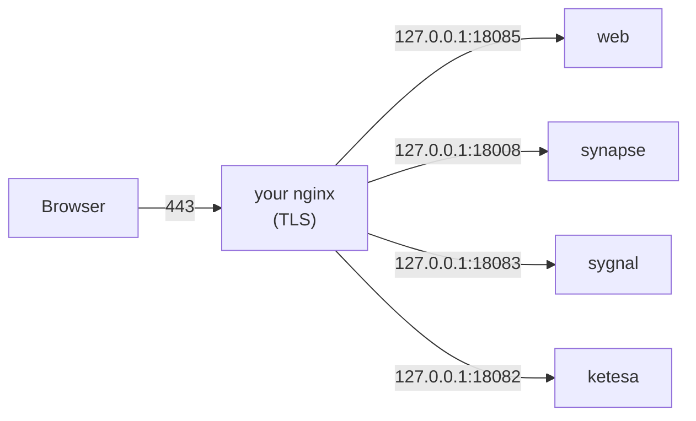

# Running Peyvand behind nginx

The default install uses **Caddy**, which needs ports 80 and 443 for itself. If your server already runs
**nginx** (for other websites, or just because you prefer it), ports 80 and 443 are taken and Caddy can't start.
Run Peyvand without Caddy and let your nginx serve it instead.

This is how the original Peyvand server runs in production.



The containers listen on `127.0.0.1` only, so nothing but nginx can reach them.

## 1. Point the stack at nginx

Do the normal steps from the README first: clone the repo, `cp .env.example .env` and set `APP_DOMAIN`,
`MATRIX_DOMAIN` and `ADMIN_EMAIL`. Then add this line to `.env`:

```ini
COMPOSE_FILE=compose.yml:compose.nginx.yml
```

From now on every `docker compose` command uses [`compose.nginx.yml`](../compose.nginx.yml) as well. It:

- leaves Caddy out;
- publishes `web`, `synapse`, `sygnal` and `ketesa` on `127.0.0.1` ports `18085`, `18008`, `18083` and `18082`.

If one of these ports is already used on your server, pick another one in `.env`:

```ini
WEB_LOCAL_PORT=18085
SYNAPSE_LOCAL_PORT=18008
SYGNAL_LOCAL_PORT=18083
KETESA_LOCAL_PORT=18082
```

Start the stack:

```bash
docker compose up -d
```

## 2. Get certificates

Skip this step if you already have certificates for both domains, for example a wildcard certificate or a CDN
origin certificate. Use their paths in step 3 instead.

Otherwise get free Let's Encrypt certificates with certbot, through nginx on port 80:

```bash
sudo apt install certbot
sudo mkdir -p /var/www/letsencrypt

# A config with only the port 80 part, so nginx can start before the certificates exist
scripts/nginx-config.sh --http-only | sudo tee /etc/nginx/conf.d/peyvand.conf
sudo nginx -t && sudo systemctl reload nginx

sudo certbot certonly --webroot -w /var/www/letsencrypt \
  -d chat.example.com --cert-name chat.example.com
sudo certbot certonly --webroot -w /var/www/letsencrypt \
  -d matrix.example.com --cert-name matrix.example.com
```

Use your own domains in place of `chat.example.com` (`APP_DOMAIN`) and `matrix.example.com` (`MATRIX_DOMAIN`).
Certbot renews the certificates by itself. To have nginx pick up the renewed ones, add a deploy hook:

```bash
echo 'systemctl reload nginx' | sudo tee /etc/letsencrypt/renewal-hooks/deploy/reload-nginx.sh
sudo chmod +x /etc/letsencrypt/renewal-hooks/deploy/reload-nginx.sh
```

## 3. Install the nginx config

```bash
scripts/nginx-config.sh | sudo tee /etc/nginx/conf.d/peyvand.conf
sudo nginx -t && sudo systemctl reload nginx
```

The script fills your domains and ports from `.env` into
[`server/nginx/peyvand.conf.template`](../server/nginx/peyvand.conf.template). Read the result before
installing it. It expects the certificates in `/etc/letsencrypt/live/<domain>/`. If yours are somewhere else, change
the `ssl_certificate` lines.

> [!NOTE]
> On Debian and Ubuntu, files in `/etc/nginx/conf.d/` are loaded automatically. If your nginx only loads
> `sites-enabled`, put the file in `/etc/nginx/sites-available/` and link it into `sites-enabled`.

What the config does, in the same way as the Caddy setup:

| Domain | Path | Goes to |
|---|---|---|
| `APP_DOMAIN` | everything | `web` (the app) |
| `MATRIX_DOMAIN` | `/.well-known/matrix/server` and `/client` | answered by nginx itself |
| `MATRIX_DOMAIN` | `/_matrix/push/v1/notify` | `sygnal` (notifications) |
| `MATRIX_DOMAIN` | `/admin/` | `ketesa` (admin UI) |
| `MATRIX_DOMAIN` | `/_matrix`, `/_synapse/client`, `/_synapse/admin` | `synapse` |
| `MATRIX_DOMAIN` | anything else | redirect to the app |

It also allows uploads of up to 100 MB and keeps long `/sync` requests open (no buffering, 10-minute timeouts).

Then create the first admin and sign in, as in the README:

```bash
scripts/create-admin.sh alice
```

## Already using nginx for something else?

Nothing else on the server changes. The Peyvand config only answers for its own two domains, and your other
`server` blocks keep working. Things to check:

- **Another site is the `default_server` on 443.** That's fine: requests for the Peyvand domains still reach the
  Peyvand blocks by `server_name`.
- **Port 8448 isn't needed.** Federation is announced on 443 through `/.well-known/matrix/server`.
- **Calls** don't go through nginx at all. The TURN server (`coturn`) uses host networking and needs **3478**
  (UDP and TCP) and **49160–49250** (UDP) open in the firewall, as in the README.
- **Other proxies** (Apache, Traefik, HAProxy, Nginx Proxy Manager) work the same way: route the paths from the
  table above to the `127.0.0.1` ports. Set `proxy_buffering off` (or the equivalent) and long timeouts for Synapse.

## Behind a CDN (Cloudflare, ArvanCloud, …)

- Set the CDN's SSL mode to **Full**. nginx can then use the CDN's origin certificate, or a self-signed one, in
  place of Let's Encrypt.
- Don't cache `/_matrix/*` or `/_synapse/*`.
- Calls need the server's real IP: set `PUBLIC_IP` in `.env`, since CDNs don't pass the UDP traffic TURN uses.

## Troubleshooting

| Symptom | Check |
|---|---|
| `502 Bad Gateway` | Is the stack running (`docker compose ps`)? Do the ports in `.env` match the generated config? |
| `nginx -t` complains about a missing certificate | Run step 2, or point `ssl_certificate` at your own files. |
| `unknown directive "http2"` or `duplicate listen options` | Another `server` block already sets `http2` or `default_server` on 443 differently. Make the `listen` lines match. |
| Sign-in works but messages arrive late | `proxy_buffering off` is missing on the Synapse location. |
| Files over 1 MB fail to upload | `client_max_body_size` is missing on `MATRIX_DOMAIN`. |
| Other servers can't reach yours | Open `https://federationtester.matrix.org/#MATRIX_DOMAIN`. `/.well-known/matrix/server` must be served by `MATRIX_DOMAIN`. |
